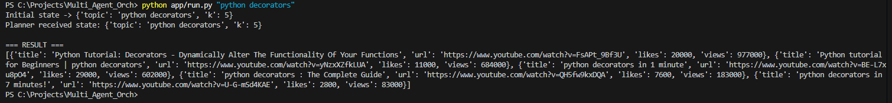

# 🧠 Multi-Agent Orchestrator — Project Documentation

This repository demonstrates an end-to-end **multi-agent orchestration workflow**.  
It integrates a **LangGraph-based planner**, an **MCP (Model Context Protocol)** client–server pair,  
and async orchestration logic for calling dynamic tools such as YouTube search or mock data generators.

---

## 📁 Project Structure Overview

| File | Description |
|------|--------------|
| `app/run.py` | Main entry point. Loads environment variables, starts the MCP client, builds the planning graph, and invokes the workflow for a given topic. |
| `app/mcp_client.py` | Implements the MCPClient class that connects to the MCP server via stdio, lists tools, and calls tools asynchronously. |
| `app/agent.py` | Defines the agent planner (make_planner). Specifies how the agent decides which tool to call and what the plan looks like. |
| `app/graph.py` | Constructs the LangGraph execution graph and orchestrates flow between planning and execution nodes. |
| `mcp_server/server.py` | Defines the MCP server that exposes tools (mock_search, youtube_search, etc.) to the client. |
| `requirements.txt` | Lists Python dependencies (LangGraph, MCP, httpx, dotenv, etc.). |

---

## 🔍 Detailed Module Breakdown

### `app/run.py`
- Loads environment variables using dotenv.  
- Reads topic from CLI args (`python app/run.py "python decorators"`).  
- Initializes MCPClient, which connects to the MCP server.  
- Creates planner and async execution node (`exec_node`).  
- Calls tools via MCP (mock_search or YouTube).  
- Normalizes and ranks results by likes + views.

### `app/mcp_client.py`
- Asynchronous context manager for MCP connections.  
- `__aenter__()` starts a stdio session.  
- `list_tools()` lists available tools.  
- `call_tool()` sends requests and parses structured JSON/text.  
- Handles normalization and error safety.

### `app/agent.py`
- Contains `make_planner()` — the agent logic.  
- Defines plan nodes and decision-making logic.  
- Each plan node decides which tool to use next.  
- Modular for adding more tools or agent strategies.

### `app/graph.py`
- Builds the **LangGraph** directed execution flow.  
- Connects plan → execute → result nodes.  
- Supports async state propagation.  
- Central to how tasks get executed in sequence.

### `mcp_server/server.py`
- Implements MCP FastMCP server exposing tools.  
- Tools: `mock_search`, optional `youtube_search`.  
- Uses decorators (`@mcp.tool()`) for registration.  
- Loads `.env` for API keys (e.g., YOUTUBE_API_KEY).  
- Returns results as structured JSON.

### `requirements.txt`
```
langgraph
mcp
httpx
python-dotenv
asyncio
```
Install with:
```bash
pip install -r requirements.txt
```

---

## ⚙️ Execution Flow

1. User runs:
   ```bash
   python app/run.py "python decorators"
   ```
2. `run.py` loads `.env` and starts `MCPClient`.  
3. `MCPClient` connects to the MCP server.  
4. Planner (`agent.py`) decides which tool to call.  
5. `exec_node` executes the tool via MCP.  
6. MCP server runs the tool (e.g., `mock_search`).  
7. Results are normalized, ranked, and printed.

---

## 🧪 Example Run

```bash
python app/run.py "python decorators"
```

**Output:**
```text
Initial state -> {'topic': 'python decorators', 'k': 5}
=== RESULT ===
[
  {"title": "python decorators Crash Course", "likes": 1500, "views": 220000},
  ...
]
```

---

## 🚀 Future Extensions

- Replace `mock_search` with live YouTube/Bing APIs.  
- Add **LangGraph memory** for long-term context.  
- Support **multi-agent negotiation** (planner + evaluator).  
- Integrate **LLM reasoning** for topic selection.

---

### 🧩 Summary

This system provides a **complete, modular pipeline** to test and orchestrate tool-calling agents using the Model Context Protocol.  
You can easily extend it to integrate real APIs, use LLM reasoning, or deploy on cloud servers via Docker/Kubernetes.

